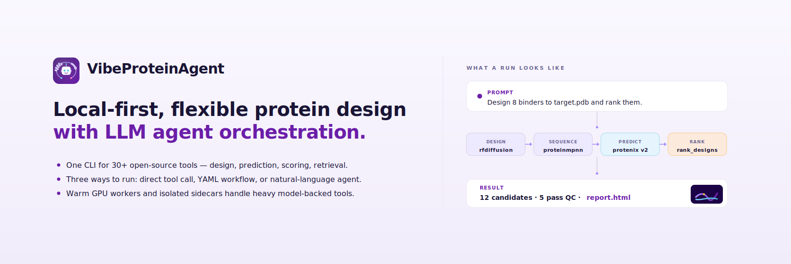
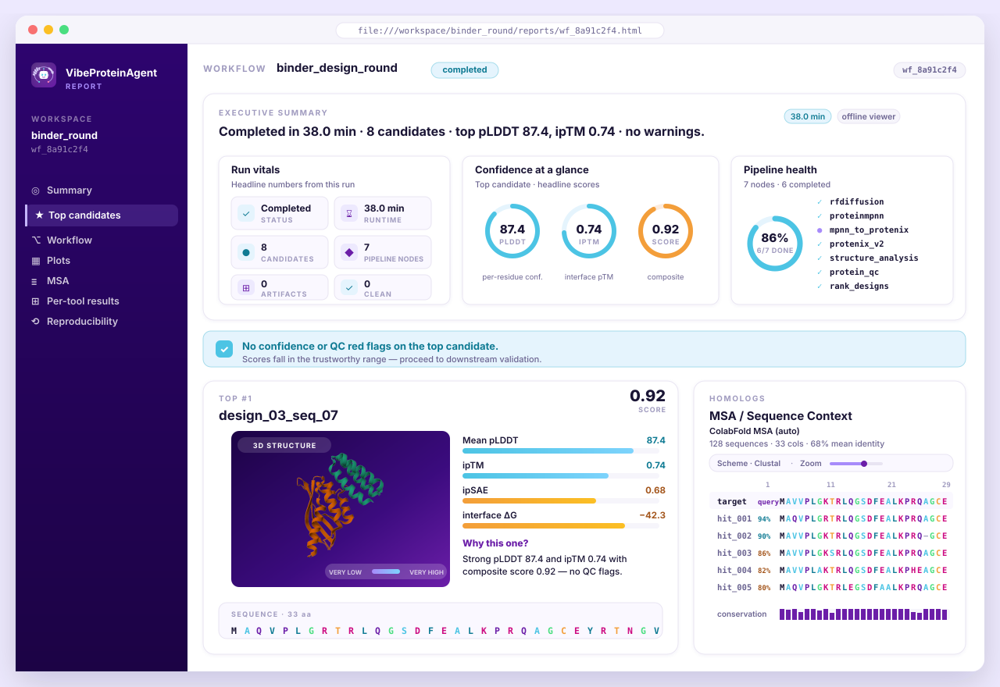
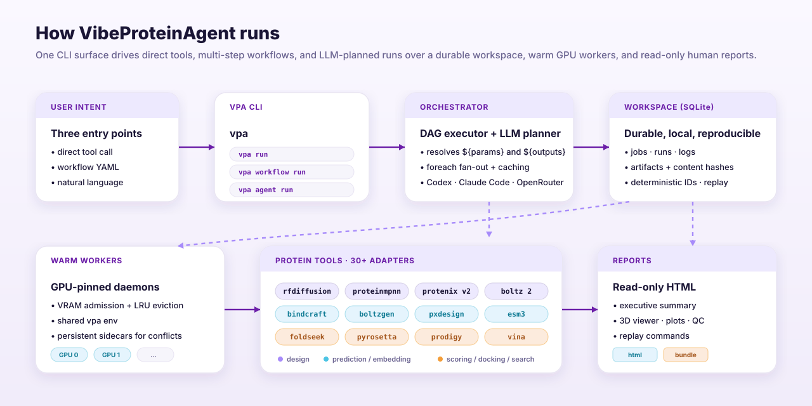

# VibeProteinAgent

[](LICENSE)
[](#license)
[](pyproject.toml)

**VibeProteinAgent (VPA)** is a non-commercial, local-first protein design framework that lets
you run individual tools, reusable workflows, or an LLM agent that chooses tools
for you. It is built for GPU-backed deep-learning protein design, structure
prediction, sequence/structure search, literature evidence gathering,
GO/InterPro-based sequence retrieval, QC, ranking, visualization, and
human-readable reports.

<!--  -->


> [!IMPORTANT]
> **Non-commercial use only.** VibeProteinAgent is licensed under the
> [PolyForm Noncommercial License 1.0.0](LICENSE) — free for academic research,
> education, personal projects, and other non-commercial purposes. Commercial
> use (paid services that wrap VPA, internal use at a for-profit company beyond
> evaluation, or redistribution as part of a commercial product) requires a
> separate license; please [open an issue](../../issues) to inquire. Third-party
> tools and model weights bundled by `vpa install` keep their own licenses —
> see [`vendor/*/LICENSE`](vendor/) and `vendor/*/UPSTREAM.md` before
> redistributing or running them.

## Why Use VPA?

- **One interface for many protein tools:** generation, inverse folding,
  structure prediction, retrieval, QC, scoring, docking, visualization, and
  reporting all run through `vpa`.
- **Free local runs when you have GPUs:** run local open-source tools on your
  own GPU without per-job API fees or required paid model subscriptions.
- **Use it your way:** call one tool directly, chain tools in a workflow, or let
  an LLM agent plan tool use from a natural-language request.
- **Not locked to one LLM:** agent mode supports multiple providers, including
  Codex, Claude Code, and OpenRouter models, so teams can choose the planner
  that fits their account, policy, and task.
- **Local-first execution:** jobs, artifacts, cache metadata, and reports live in
  your workspace instead of disappearing into a remote black box.
- **Heavy-tool friendly:** persistent workers and sidecars are designed for
  model-backed tools that are expensive to cold-start.

## How VPA Works

VPA gives every run a durable workspace. The CLI submits jobs, workflows, or
agent plans into that workspace; warm workers execute tools; artifacts and cache
keys are recorded; reports turn the result into something humans can inspect.



| Layer | What it does |
|---|---|
| `vpa run` | Run one tool directly with explicit parameters. |
| `vpa workflow run` | Connect several tools with a YAML workflow. |
| `vpa agent run` | Let an LLM planner select tools/workflows from the public tool surface. |
| Workspace | Stores jobs, logs, artifacts, workflow state, cache metadata, and reports. |
| Workers | Persistent local processes that run tools from the shared VPA env or sidecars. |
| Reports | Read-only HTML output with summaries, structures, plots, QC, MSA context, and replay metadata. |

## Installation

External users should use the npm/npx bootstrapper. It creates
`~/.vibeproteinagent`, installs the VPA conda env, selected sidecars, and model
weights. Use `VPA_HOME=/path/to/root` if you want a different install location.

```bash
# Optional for ESM3 or other gated Hugging Face downloads.
export HF_TOKEN=<huggingface-access-token>

# Optional; only needed when running `vpa agent ... --provider openrouter`.
export OPENROUTER_API_KEY=<openrouter-api-key>

# Check the host GPU/driver/toolkit contract before a heavy install.
npx vibeproteinagent install preflight --profile full --cuda-profile auto --json

# Full agent/tool experience: all first-class tools, sidecars, and weights.
npx vibeproteinagent install --profile full --cuda-profile auto --yes

# Agent mode without forcing every heavyweight model install.
npx vibeproteinagent install --profile agent --yes

# Select only the heavyweight tools you need.
npx vibeproteinagent install --tools rfdiffusion,proteinmpnn,protenix_v2 --cuda-profile auto --yes

# Preview selected tools, disk estimate, and install steps first.
npx vibeproteinagent install --profile full --dry-run --json
```

### Install Footprint

These are practical planning numbers. Run `--dry-run --json` on your machine
before a large install.

| Install choice | What it includes | Approximate footprint |
|---|---|---:|
| `--profile base` | Core VPA runtime + lightweight analysis/QC/ranking tools | conda env only; no large model weights selected |
| `--profile agent` | `base` + retrieval/template tools for LLM planning; provider credentials are only needed at runtime | conda env only; no large model weights selected |
| `--tools rfdiffusion,proteinmpnn,protenix_v2` | Backbone generation + sequence design + structure prediction | ~10.1 GB tool artifacts, plus env/cache |
| `--tools boltz2_affinity,rfdiffusion,proteinmpnn` | Affinity prediction + RFdiffusion + ProteinMPNN | ~14.1 GB tool artifacts, plus env/cache |
| `--profile full` | Every first-class tool, sidecar, and required checkpoint; optional/gated tools become ready when their cache or credentials are available | ~240 GB tool artifacts, plus env/cache |

If you already have validated sidecar environments, pass
`--use-prebuilt-sidecars` and export the matching path, for example
`VPA_BINDCRAFT_ENV_PATH`, `VPA_PROTEINA_COMPLEXA_VENV`,
`VPA_PXDESIGN_PIPELINE_ENV`, or `VPA_RFDIFFUSION3_ENV`. VPA will link/reuse
those envs instead of resolving a fresh fragile sidecar when possible.

### Credentials

VPA never needs you to store credential values in the repository. Export them in
your shell or CI secret store only when the selected install/run path needs
them:

```bash
# ESM3 first-run downloads or gated Hugging Face model variants.
export HF_TOKEN=<huggingface-access-token>

# OpenRouter-backed agent planning.
export OPENROUTER_API_KEY=<openrouter-api-key>
```

`VPA_HF_CREDENTIAL` and `VPA_OPENROUTER_CREDENTIAL` are also accepted aliases.
`--profile agent` installs without an OpenRouter key because the default agent
provider is the local Codex CLI. `--profile full` includes ESM3; it can install
without a Hugging Face credential if the open ESM3 cache is already present, but
first-run downloads or gated variants may require `HF_TOKEN` plus accepted model
terms on Hugging Face.

### GPU Requirements

GPU memory depends on the selected model, input size, and sampling settings.
VPA's tested GPU stack currently targets CUDA 12.8-era packages, including
PyTorch 2.7.1+cu128 and CUDA 12.x sidecar dependencies. We recommend NVIDIA
driver 570+ on Linux for CUDA 12.8 workflows.

`--cuda-profile auto` is the default. It selects the primary `cu128` stack on
compatible hosts and can fall back to `cu126` for older CUDA 12.6-era drivers.
Use `--cuda-profile cpu` only for base/agent/lightweight checks; GPU-heavy tools
will not become fully ready under the CPU profile.

VPA is primarily validated on NVIDIA B200 GPUs. H100/H200, RTX 4090, and
RTX 3090 are CUDA 12.8-capable, and most cu128 sidecars should install on them
when a recent driver is present. Workflow success still depends on VRAM and on
whether CUDA-compiling tools can find a matching nvcc/CUDA toolkit. H100/H200
class GPUs are expected to work for most workflows; older or smaller GPUs such
as RTX 3090 can run many tools, especially base/agent tools and smaller model
settings, but heavyweight workflows may require reduced lengths, batch sizes,
diffusion steps, or samples. Proteina-Complexa and RFdiffusion/RFpeptides are
more environment-sensitive because they combine PyTorch/JAX/PyG/DGL/tmol/
PyRosetta-style dependencies.

Before installation, run `vpa install preflight --profile full --cuda-profile
auto`. After installation, run `vpa install doctor` and a small smoke job for
the tools you plan to use. If host dependency resolution is fragile, the repo
also provides Docker and Apptainer CUDA 12.8 fallback definitions under
[`containers/`](containers/).

## Start

```bash
# Check the installed runtime and tool readiness.
vpa version
vpa install doctor --tools rfdiffusion,proteinmpnn,protenix_v2

# Create a workspace and start one worker.
vpa workspace create my_run
vpa daemon start --workers 1 --workspace my_run

# Run one direct tool job.
vpa run proteinmpnn \
  pdb_path=tests/fixtures/6MRR.pdb \
  num_designs=2 \
  seed=17 \
  --workspace my_run \
  --follow

# Inspect the job output.
vpa status <job_id> --workspace my_run
vpa results <job_id> --workspace my_run
vpa artifacts <job_id> --workspace my_run
```

## Tools

Check your local tool surface at any time:

```bash
vpa tools
vpa tools --json
vpa tool info rfdiffusion
vpa install doctor --tools rfdiffusion,proteinmpnn,protenix_v2
```

VPA can also discover custom tools. Add a drop-in adapter under
`~/.vibeproteinagent/tools/<tool>/`, or ship one from a Python package through
the `vibeproteinagent.tools` entry point, and it can appear in the same `vpa
tools` surface. If there is a tool you would like VPA to support, please open a
GitHub issue with the request, or a PR if you already have an adapter. I will
add requested tools as time allows.

| Tool | Category | Use |
|---|---|---|
| `rfdiffusion` | protein design | RFdiffusion backbone generation: unconditional, motif, partial diffusion, binder, fold-conditioned, and symmetric designs. |
| `proteinmpnn` | inverse folding | Fast sequence design for fixed protein backbones, often used after backbone generation. |
| `protenix_v2` | structure prediction | AlphaFold3-like protein/complex structure prediction for refolding and candidate validation. |
| `boltz2_affinity` | structure prediction | Boltz-2 structure prediction plus calibrated binding affinity for protein-ligand or complex assessment. |
| `bindcraft` | protein design | AF2-backprop binder hallucination with ProteinMPNN redesign and downstream scoring. |
| `boltzgen` | protein design | Binder generation pipeline with diffusion, inverse folding, refolding, and filtering. |
| `proteina_complexa` | protein design | Unified Proteina-Complexa modes for protein binders, ligand binders, and motif scaffolding. |
| `pxdesign` | protein design | Target-conditioned binder design using diffusion-style protein generation and optional pipeline scoring. |
| `rfdiffusion3` | protein design | RFdiffusion3 binder backbone generation for modern de novo and target-conditioned design runs. |
| `rfpeptides` | protein design | RFdiffusion-based macrocyclic peptide backbone generation for constrained peptide binders. |
| `esm3` | embedding/design | ESM3 sequence/structure co-generation, embeddings, and functional keyword conditioning. |
| `esm2` | protein design | Protein language model that supports unconditional and masked partial-sequence generation and representation extraction. |
| `ligandmpnn` | inverse folding | Ligand-aware sequence design over fixed backbones while considering nearby small molecules. |
| `rank_designs` | analysis | Deterministic ranking of candidates from prediction metrics, structure analysis, and QC flags. |
| `sequence_analysis` | analysis | CPU sequence metrics, residue annotations, composition, charge, and simple liabilities. |
| `structure_analysis` | analysis | Local structure checks for contacts, exposure, residue environment, and mutation liabilities. |
| `protein_qc` | scoring/QC | pLDDT, GRAVY, instability, pI, and sequence/structure quality control (QC) flags. |
| `ipsae` | scoring | Interface-confidence re-scoring from structure prediction outputs; useful as an in silico binder-design filter. |
| `prodigy` | scoring | Structure-based protein-protein binding affinity and interface assessment. |
| `pxmeter` | scoring | Structural accuracy assessment with metrics such as lDDT and DockQ for predicted designs. |
| `pyrosetta` | scoring | Energy scoring, interface metrics, relaxation, and packing for structure-level triage. |
| `tmalign` | scoring | Pairwise protein structure alignment with TM-score style similarity comparison. |
| `vina` | docking | AutoDock Vina molecular docking for small-molecule pose and affinity-style screening. |
| `dssp` | structure annotation | Secondary-structure assignment and backbone annotation from PDB/mmCIF structures. |
| `foldseek` | search | Fast structural similarity search against local structure databases. |
| `mmseqs2_gpu` | search | GPU-accelerated sequence similarity search for large FASTA/database queries. |
| `template_select` | retrieval | Local FASTA template selection for choosing sequence templates before design or prediction. |
| `literature_search` | retrieval | Europe PMC literature search that creates lightweight evidence artifacts for design context. |
| `interpro_sequences` | retrieval | UniProt sequence retrieval for InterPro accessions or domain-family driven searches. |
| `go_sequences` | retrieval | UniProt sequence retrieval for GO terms, useful for function-guided sequence collection. |
| `sequence_edit` | sequence engineering | Deterministic residue substitutions, sequence edits, and wild-type consistency checks. |
| `colabdesign_utils` | utility | ColabDesign capability and readiness accounting for workflows that depend on that ecosystem. |

## Three Ways To Use VPA

### 1. Run One Or A Few Tools Yourself

Use this when you know exactly which tool you want and prefer to decide the next
step manually.

```bash
vpa run proteinmpnn pdb_path=target.pdb num_designs=8 --workspace my_run --follow
vpa run protein_qc sequence=ACDEFGHIKLMNPQRSTVWY --workspace my_run
vpa report <job_id> --workspace my_run --open
```

Guide: [docs/use_tools.md](docs/use_tools.md)
Notebook: [demo/use_tools_demo.ipynb](demo/use_tools_demo.ipynb)

### 2. Run A Workflow

Use this when outputs from one tool should feed the next tool automatically.

```bash
vpa workflow run <your_workflow.yaml> \
  --param target_pdb=target.pdb \
  --workspace binder_round \
  --follow
```

A workflow YAML declares inputs once under `params`, then lists ordered `nodes`
that call VPA tools. Later nodes can reuse earlier outputs, so users do not have
to manually find intermediate FASTA/PDB/CIF paths.

```yaml
name: binder_refold_qc
params:
  backbone_pdb: {type: str, required: true}
  num_designs: {type: int, default: 4}
nodes:
  - id: design_sequences
    tool: proteinmpnn
    inputs:
      pdb_path: ${params.backbone_pdb}
      num_designs: ${params.num_designs}

  - id: qc_sequences
    tool: protein_qc
    foreach: ${outputs.design_sequences.designs}
    inputs:
      sequence: ${item.sequence}
```

The full workflow guide shows how to extend this pattern into generation →
sequence design → structure prediction → QC → ranking.

Guide: [docs/use_workflows.md](docs/use_workflows.md)
Notebook: [demo/use_workflows_demo.ipynb](demo/use_workflows_demo.ipynb)

### 3. Use The LLM Agent

Use this when you want to describe the scientific goal in natural language and
let an LLM planner choose tools/workflows from the public VPA tool list. VPA is
provider-flexible: you can use Codex, Claude Code, or OpenRouter-backed models
without changing the underlying tool/workflow runtime.

```bash
vpa agent run \
  "Design binder backbones for target.pdb, design sequences, refold candidates, run QC, and rank the best designs." \
  --provider codex \
  --model gpt-5.2 \
  --workspace agent_round \
  --max-rounds 8 \
  --max-entries 3 \
  --max-wait-s 7200
```

`--max-rounds` defaults to `8`; `--max-entries` defaults to `3` and fails fast
after repeated timeout or invalid LLM planning/decision entries.

For local CLI providers, log in once on the machine where `vpa agent run` will
execute. VPA does not store these credentials in the repository:

```bash
# Codex CLI provider
codex login

# Claude Code CLI provider
claude /login
```

Switch providers per run:

```bash
vpa agent run "Plan a binder design round for target.pdb" --provider claude-code --model sonnet --plan-only
vpa agent run "Plan a binder design round for target.pdb" --provider openrouter --model openai/gpt-5.1 --plan-only
```

Use `--plan-only` when you want to inspect the proposed plan without running
tools.

Guide: [docs/use_llm_agent.md](docs/use_llm_agent.md)
Notebook: [demo/use_llm_agent_demo.ipynb](demo/use_llm_agent_demo.ipynb)

## Human Reports

`vpa report` creates a human-facing HTML report from a completed job or
workflow. It is read-only: it summarizes existing artifacts and never launches
new scientific jobs.

<!--  -->

```bash
# Self-contained HTML report.
vpa report <job_or_workflow_id> --workspace my_run --viewer offline --out report.html --open

# Bundle mode for larger outputs.
vpa report <job_or_workflow_id> --workspace my_run --format bundle --out report_bundle
```

Reports include:

| Section | What you see |
|---|---|
| Executive summary | Natural-language result summary and next suggested action. |
| Workflow DAG | Completed, cached, failed, skipped, or partial nodes. |
| Top candidates | Structure viewer, score bars, sequence/QC context, and "why this one" text. |
| All designs | Sortable candidate table. |
| Plots and MSA | Score plots, QC plots, and MSA/FASTA visualization when artifacts exist. |
| Reproducibility | Tool versions, IDs, params hashes, artifact hashes, and replay commands. |

You can also open structures directly:

```bash
# Rich report-style 3D viewer.
vpa visualize design.pdb --viewer online --out design_viewer.html

# Network-free lightweight viewer.
vpa visualize --job-id <job_id> --workspace my_run --viewer offline --out job_viewer.html
```

## Demo Notebooks And Short Guides

The notebooks are smoke-safe by default: they validate GPU/CLI access and print
long model or LLM commands unless you explicitly opt in with
`VPA_DEMO_RUN_HEAVY=1` and/or `VPA_DEMO_RUN_LLM=1`.

| Intent | Markdown guide | Notebook |
|---|---|---|
| Run one or a few tools manually | [docs/use_tools.md](docs/use_tools.md) | [demo/use_tools_demo.ipynb](demo/use_tools_demo.ipynb) |
| Run a multi-step workflow | [docs/use_workflows.md](docs/use_workflows.md) | [demo/use_workflows_demo.ipynb](demo/use_workflows_demo.ipynb) |
| Use the LLM agent | [docs/use_llm_agent.md](docs/use_llm_agent.md) | [demo/use_llm_agent_demo.ipynb](demo/use_llm_agent_demo.ipynb) |

## License

VibeProteinAgent first-party code is released for non-commercial use under the
[PolyForm Noncommercial License 1.0.0](LICENSE). Third-party tools, model
weights, and vendored or pointer-vendored upstream components remain under
their own licenses and terms; see the relevant `vendor/*/LICENSE` and
`vendor/*/UPSTREAM.md` files before redistributing or running them.

## Cite

If you use VibeProteinAgent in your research, please cite:

```bibtex
@software{vpa2026vibeproteinagent,
  author       = {VibeProteinAgent contributors},
  title        = {VibeProteinAgent},
  year         = {2026},
  publisher    = {GitHub},
  url          = {https://github.com/<your-org>/VibeProteinAgent}
}
```

Citation metadata is also available in [CITATION.cff](CITATION.cff).
