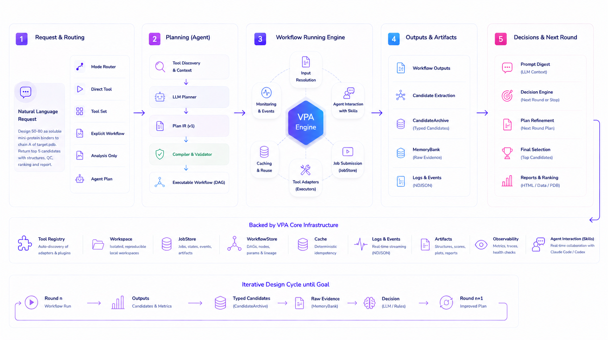

<h1>VibeProteinAgent</h1>

[](LICENSE)
[](#license)
[](pyproject.toml)

**VibeProteinAgent (VPA)** is a local-first, GPU-ready protein design
framework. It lets an agent install and run protein design tools, keep durable
workspace evidence, and produce inspectable reports from natural-language
protein requests.

<!--  -->


## Why Use VPA?

- **One interface for many protein tools.** VPA wraps retrieval, sequence
  analysis, backbone and binder design, structure prediction, docking, QC,
  ranking, and reporting behind one `vpa` command surface.
- **Agent-first workflow.** Codex, Claude Code, or another coding agent reads
  the repo instructions, chooses the right VPA workflow, runs it, checks
  evidence, and reports the result.
- **Local-first execution.** Workspaces, logs, candidate records, artifacts,
  caches, and reports stay on your machine or cluster storage.
- **GPU-tool friendly.** Persistent workers and sidecars reduce cold starts for
  heavyweight protein models.
- **Reportable results.** Completed agent runs, workflows, and direct jobs can
  be rendered as HTML or bundle reports for inspection and replay.

## Use With Codex

Open this repository in Codex and ask it to install VPA:

```text
Install VibeProteinAgent into /vpa.
Use VPA_HOME=/vpa, install the full profile with CUDA auto-detection, run
vpa install doctor --profile full, and tell me whether VPA is ready.
```

Then send a protein request:

```text
Run this VPA query in workspace [workspace name]:
Design 50-80 aa soluble mini-protein binders to chain A of `[your_folder]/target.pdb`.
Return the top 5 candidates with structures, QC, ranking, and an HTML report.
```

Codex reads [AGENTS.md](AGENTS.md) and [skills.md](skills.md) from this repo, so
plain natural language is the portable interface. Codex custom slash prompts are
local to `~/.codex/prompts`; this repository does not rely on them.

## Use With Claude Code

Open this repository in Claude Code. You can use the same natural-language
prompts as above, or use the project command included in this repo:

```text
/vpa Install VibeProteinAgent into /vpa. Use the full profile, CUDA
auto-detection, and run doctor when done.
```

Then run a query:

```text
/vpa Run this VPA query in workspace [workspace name]:
Design 50-80 aa soluble mini-protein binders to chain A of `[your_folder]/target.pdb`.
Return the top 5 candidates with structures, QC, ranking, and an HTML report.
```

The `/vpa` command is defined at [.claude/commands/vpa.md](.claude/commands/vpa.md).
It is a Claude Code convenience wrapper around the same repo instructions.

## What The Agent Runs

For installation, the agent should run the equivalent of:

```bash
export VPA_HOME=/vpa
npx vibeproteinagent install --profile full --cuda-profile auto --yes
source /vpa/env.sh
vpa install doctor --profile full
```

If your environment needs gated model downloads, provide the needed token first:

```bash
export HF_TOKEN=<huggingface-access-token>
```

## Example Protein Queries

After installation, include the target file, goal, constraints, and what you want
back.

```text
Run this VPA query in workspace [workspace name]:
Design 50-80 aa soluble mini-protein binders to chain A of `[your_folder]/target.pdb`.
Return the top 5 candidates with structures, QC, ranking, and an HTML report.
```

For retrieval or analysis:

```text
Run this VPA query in workspace [workspace name]:
Find representative proteins for this GO term, screen sequence liabilities,
rank the strongest candidates, and generate a report.
```

For a sequence-only check:

```text
Run this VPA query in workspace [workspace name]:
Analyze this sequence for basic developability risks and report the evidence:
ACDEFGHIKLMNPQRSTVWY
```

Or provide a FASTA file path instead of pasting the sequence:

```text
Run this VPA query in workspace [workspace name]:
Analyze the FASTA file at `[your_folder]/sequences.fasta` for basic developability
risks and report the evidence.
```

The agent should handle workspace setup, workers, planning, execution, ranking,
submission or answer selection, and report generation through VPA's repo
instructions in [AGENTS.md](AGENTS.md), [skills.md](skills.md), and
[agent_workflows/](agent_workflows/).

## Cite

If you use VPA in research, cite:

```bibtex
@software{vpa2026vibeproteinagent,
  author       = {Hyunjin Seo},
  title        = {VibeProteinAgent},
  year         = {2026},
  publisher    = {GitHub},
  url          = {https://github.com/trillion-labs/VibeProteinAgent}
}
```

Citation metadata is also available in [CITATION.cff](CITATION.cff).

Questions about VPA can be directed to Hyunjin Seo at bella72@kaist.ac.kr.

## License

VPA first-party code is released for non-commercial use under the
[PolyForm Noncommercial License 1.0.0](LICENSE). Commercial use requires a
separate license. Third-party tools, model weights, sidecars, and vendored or
pointer-vendored upstream components keep their own licenses and terms. Review
[THIRD_PARTY_NOTICES.md](THIRD_PARTY_NOTICES.md) before redistribution or
production use.
